# Simplifying the Workbench: showing less without hiding anything

Research for discussion · 23 Oct 2026 · branch <code>claude/site-simplification-ui-research-xiwlzs</code> · no app code was changed. Companion file: <code>concept-lab.html</code> (five animated sketches, referred to below as the Concept Lab).

## 0. The short version

**Your questions, answered first.**

| You asked | Short answer | Where |
|---|---|---|
| What is important to show up front? | The things that decide the next step and the things the doctrine forbids hiding: claim status, flag level with "indicator, not a finding", where a fact comes from, what is AI-made, the publication gates, safety notices, failed files, contradictions, and the counts "found / shown / why it stopped". Everything else can sit one step down. | §3 |
| What can be nested? | Rule versions and weights, entity-resolution audit, connector and OpenAleph internals, the 2,946-indicator catalogue beyond what the app actually computes (7 rules), per-run AI operating instructions, themes and effects, tokens and security logs. | §3, §7.2 |
| How much at once? | Research gives no fixed number. Choice time grows with the log of the number of options (Hick), and people hold about four chunks (Cowan), not seven. So the useful move is grouping into few labelled groups at each level, not trimming a long flat list. | §4 |
| How do we stop the overwhelm? | Four moves, used together: (1) fold what you are not on into a one-line **spine** that keeps its count and state; (2) give every record **four depths** (line, peek, opened in place, the room); (3) raise **actions only when something is selected**; (4) make long lists **zoomable** (groups, then rows, then records). | §7.4, Concept Lab |
| A complexity setting? For beginners? | Yes: one switch, three plain-word levels (**Less / Usual / Everything**), with a floor that cannot be turned off. Not a "Beginner/Expert" label. Folded things always say how many they hold. | §7.2 |
| How would people know to turn it on? | Five ways, none silent: a question when the first case opens, a switch that is always in the top edge, a command in ⌘K, an **offer** (never an automatic change) when a screen is crowded, and "N folded · show" lines where something is hidden. | §7.3 |
| Animation and event triggers? | Yes, with three rules from your own design notes and from what failed elsewhere: motion explains a change; an event may add attention but never hides or moves what you are on; values never animate (highlight a changed number, do not count it up). | §7.5 |

**What I looked at.** The whole app (15 routes, 39 feature folders, 69 data tables, 284 endpoints), the Authority System Suite doctrine, your mockups and the Media Suite board. Then 40 screenshots of other products and design guidance, read as pictures, and a dozen research papers and guidelines (some only as abstracts, §9 says which).

**The one finding that shaped everything.** The overload is mostly not the number of features. It comes from the same navigation shown in four places, from older screens that are still stacked forms (Library, Relationships, Claims, Connectors), and from screens that ask for every decision at the shallowest layer. Your newer screens (Case home, Decide, Red Flags, Money, Story) already follow the right pattern; the work is to carry that pattern to the rest and add one setting on top.

## 1. What the product holds

### 1.1 Counts

<table class="stats">
<tr><td><b>15</b>routes</td><td><b>5 + 5</b>stages + other pages in the left edge</td><td><b>~24</b>section links across the stages</td><td><b>~40</b>links in the left edge when open</td></tr>
<tr><td><b>39</b>frontend feature folders</td><td><b>~15</b>kinds of modal, drawer or sheet</td><td><b>69</b>data tables</td><td><b>284</b>API endpoints</td></tr>
<tr><td><b>2,946</b>catalogue indicators</td><td><b>7</b>of them have a computing rule</td><td><b>2,268</b>glossary terms</td><td><b>~15,000</b>items waiting in the 1MDB Decide queue</td></tr>
</table>

Screen counts below are static counts of controls in the code (buttons, inputs, selects), so they are lower bounds. I did not run the app. "Visible" figures are estimates from the code.

### 1.2 Screens ranked by how much sits on them at once

Bring in › Library<i style="width:100%"></i><em>90–130</em>

See › Relationships<i style="width:77%"></i><em>60–100</em>

Reading room<i style="width:70%"></i><em>55–90</em>

Act › Red Flags<i style="width:62%"></i><em>50–80</em>

Case home<i style="width:58%"></i><em>55–75</em>

Act › Story<i style="width:58%"></i><em>45–75</em>

See › The Wire<i style="width:54%"></i><em>40–70</em>

Act › AI runs / Watch<i style="width:54%"></i><em>40–70</em>

Bring in › The Drop<i style="width:46%"></i><em>35–60</em>

Check › Claims<i style="width:42%"></i><em>35–55</em>

Connectors + Dossier<i style="width:46%"></i><em>35–60</em>

Decide<i style="width:38%"></i><em>30–50</em>

See › Money<i style="width:34%"></i><em>25–45</em>

Settings › Appearance<i style="width:34%"></i><em>25–45</em>

Estimated interactive elements visible at once at desktop size with the edges closed (bar = upper end of the range). Source: code inventory.

The top of the list is not what you would guess from the mockups. The four heaviest are Library and Relationships (older stacked panels, redesign still pending per the build list) and the Reading room and Red Flags (redesigned, but each carries many keys and filters).

### 1.3 The kinds of information, by who needs them and how often

<table>
<tr><th>Kind</th><th>Audience</th><th>Use</th><th>Can it be hidden?</th></tr>
<tr><td>Decision cards (proposals, to-check, missing values)</td><td>everyone</td><td>every session</td><td>no: it is the work</td></tr>
<tr><td>Claim status; quote + locator + source</td><td>everyone</td><td>every session</td><td><b>no (ethics)</b></td></tr>
<tr><td>Red flag level, "indicator not a finding", innocent explanations</td><td>everyone</td><td>every session</td><td><b>no (ethics)</b></td></tr>
<tr><td>Likelihood word, evidence grade, classification, warrant, assumptions, limitations</td><td>experienced</td><td>occasional</td><td>depth can fold; the likelihood word stays</td></tr>
<tr><td>Source tier A–F, authenticity, restatement</td><td>experienced</td><td>occasional</td><td>can fold to a word</td></tr>
<tr><td>Network, timeline, places, money</td><td>everyone / forensic</td><td>every session</td><td>views are tools, not duties</td></tr>
<tr><td>Chain of custody, hash re-check</td><td>experienced</td><td>occasional</td><td>failures must surface</td></tr>
<tr><td>Entity merge audit, property conflicts</td><td>experienced</td><td>occasional</td><td>can fold; conflicts count stays</td></tr>
<tr><td>Connectors, OpenAleph corpus, cross-reference</td><td>experienced</td><td>rare</td><td>can fold; findings still reach Decide with provenance</td></tr>
<tr><td>Story gates, right of reply, legal read</td><td>everyone</td><td>at publish</td><td><b>no (ethics)</b></td></tr>
<tr><td>AI marks, "what leaves this computer"</td><td>everyone</td><td>when used</td><td><b>no (ethics)</b></td></tr>
<tr><td>AI operating instructions (tier floor, devil's advocate)</td><td>experienced</td><td>occasional</td><td>fold</td></tr>
<tr><td>Backups, deletion, tokens, security log</td><td>admin</td><td>rare</td><td>irreversible actions keep a typed confirmation</td></tr>
<tr><td>Your safety panel</td><td>everyone</td><td>always</td><td><b>no (safety)</b></td></tr>
<tr><td>Themes, effects, formats</td><td>everyone</td><td>rare</td><td>fold</td></tr>
<tr><td>Rule versions, weights, detector families, suite maintenance</td><td>maintainer</td><td>rare</td><td>fold</td></tr>
</table>

## 2. Where the overload actually comes from

1. **The same map, four times.** Stages and parts are reachable from the breadcrumb, the left edge (about 40 links when open), the section tabs on every stage page (about 24) and ⌘K, which repeats all of them. A user sees the choice set several times without gaining any choice.
2. **Older panels are stacked forms.** The build list says the stage pages "still hold the existing panels until each stage is redesigned". Library has 44 buttons, 11 selects and 8 inputs before any row. Relationships puts 7 inputs and 8 selects (including add-party and add-relationship forms with amount, currency, date, purpose) beside the graph.
3. **Everything at the shallowest depth.** A record is either a line or a whole screen. There is little between (a peek, an in-place open), so the screen fills with whole panels.
4. **Long lists have no overview.** The 1MDB Decide queue holds about 15,000 items, and its cards come one at a time. There is a group action and a progress dot row, but no zoomed-out picture of what the 15,000 are. Red Flags on 1MDB shows 37 flags of which 31 are the same rule (BO-033 once per payment).
5. **The catalogue promises more than the app computes.** 2,946 indicators are listed in Learn; 7 have computing rules. I could not confirm from the code whether the UI says this plainly; if not, it reads as a bigger system than it is.
6. **Keys and help are scattered.** The Reading room has about 14 keys, Watch the run about 19, and the `?` help lists only the 9 global ones.
7. **Many kinds of overlay.** About 15 kinds of dialog, drawer, sheet and takeover: four Radix dialogs, two `role="dialog"` takeovers, four different drawers (plan, one-thought, Wire, custody), a sheet and a pending-conflict dialog. Only two places use the shared Tabs component; every other tab set is hand-built, so behaviour will differ (my inference from the code).
8. **No setting and no tour.** There is no Simple/Advanced, density or beginner switch, no tutorial, and "Practise" is a disabled button. The edge-hiding frame is the only built-in complexity device, and it hides navigation, not content.
9. **The Media Suite board overwhelms for a different reason.** It is a board of boards: 9 top tabs, then 9 numbered chips in the first tab alone, then a numbered-notes switch, a theme switch, a Full/Calm switch, a search bar and a "Safe review" pill, before the product screen starts. In headless Chromium at 1440×900 I counted 58 buttons, tabs and links rendered on first load (some below the fold). The screen inside (the Shelf) is dense by design: 7 steps per file, three columns, a problems filter and a run button.

<figure>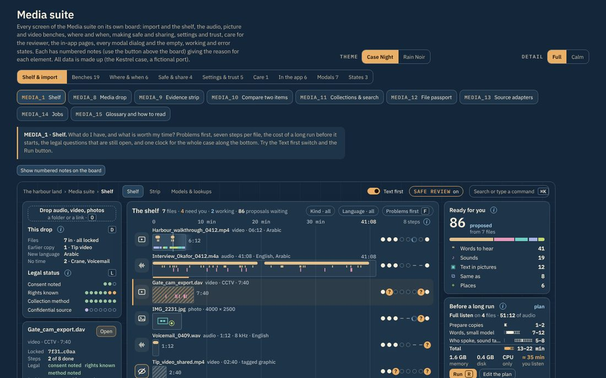<figcaption><b>Our own Media Suite board, first view.</b> The scaffolding (tabs, chips, switches) competes with the screen it is presenting. The Shelf inside already uses good moves (dots instead of words for steps, "Problems first", counts in a side column), but it shows all seven steps for every file at once.</figcaption></figure>

<figure>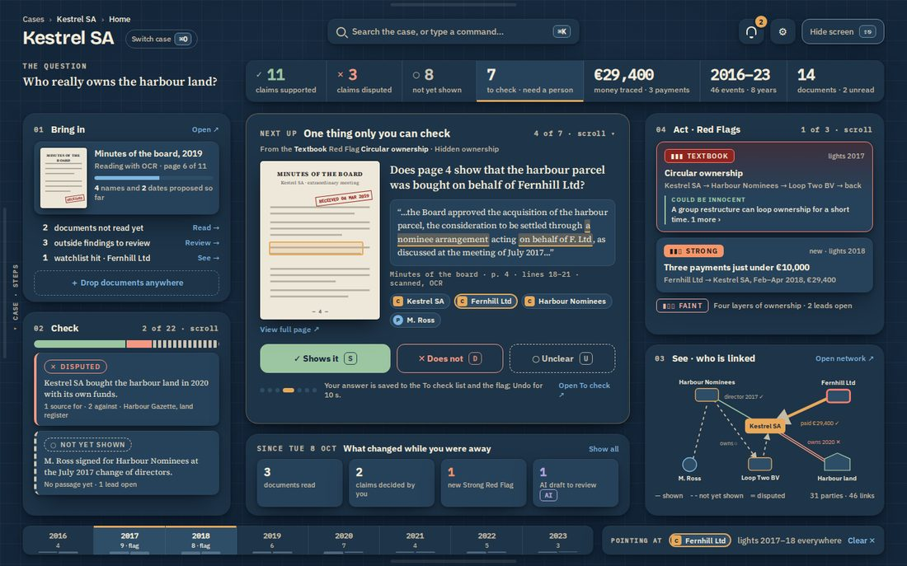<figcaption><b>Mockup HOME_1 (Case home).</b> Seven tiles, three columns, a Next-up card, a "what changed" row, a year rail: dense, but one focal point, one alarm colour, every area titled and counted.</figcaption></figure>
<figure>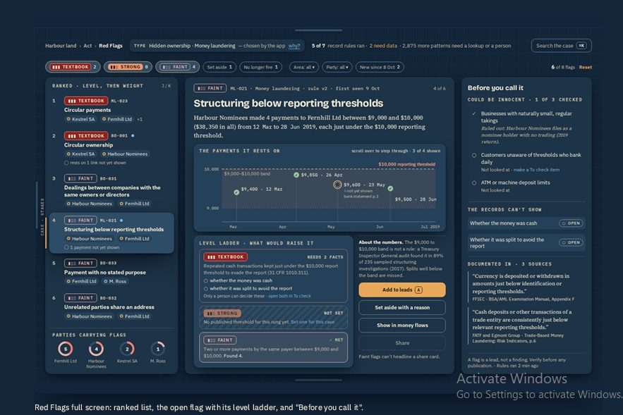<figcaption><b>Mockup ACT_1 (Red Flags).</b> Ranked list, open flag, ladder, "Before you call it". The innocent-explanation checklist sits above the evidence, as the doctrine asks.</figcaption></figure>

## 3. The floor: what simplifying may never remove

This is taken from the Authority System Suite doctrine and the Workbench rules, not from my own taste. Two sentences in the doctrine set the limit for the whole study:

- "A visual may simplify presentation, but it may not simplify away provenance, uncertainty, scope, or a material alternative explanation." (suite visual standard)
- A summary "may simplify a finding but may not raise its confidence term, widen its scope, or state an association as a cause." (calibrated confidence language)

And an overlay "may annotate and rank; it may never omit, suppress, or alter a finding." A detail level is the same kind of thing as an overlay, so it follows the same rule.

**Always visible, at every level**

1. Claim status, and any unverified, disputed or alleged state: a statement never reads as fact.
2. Red flag level, the words "indicator, not a finding", and the innocent explanations.
3. Where each fact comes from, one click away (quote, locator, source).
4. AI-made text marked as such until a person accepts it, and what leaves the computer.
5. The publication gates: every sentence sourced, right of reply, legal read, single-source statements, innocent explanations.
6. Source-protection and publication-ethics records (CP-02, CP-03).
7. Reporter-safety notices.
8. Typed confirmation on irreversible actions (delete, overwrite, send).
9. Failed or unreadable documents: they must not vanish.
10. Contradictions and conflicts, such as the 54 contradicting evidence stances on 1MDB. They can be nested one step; they cannot be dropped.
11. Counts that say how many were found, how many are shown and why it stopped (a suite rule). This is what makes folding honest: a folded panel must carry its number.
12. Confidence is capped by the weakest link, whatever the level.

**May be nested or folded by default:** rule versions and weight parts, detector families, entity-resolution audit trail, connector and OpenAleph internals, the catalogue beyond a linked glossary, per-run AI operating instructions, themes and effects, tokens, security log, orphan-file tools, console, suite-maintainer tools.

## 4. What research says

I read each of these as an abstract, an excerpt or the page itself; §9 gives the exact status. They are listed by what they change in this design.

<table>
<tr><th>Source</th><th>What it found or says</th><th>What it changes here</th></tr>
<tr><td><b>Hick's law</b> (as summarised across several UX sources; the law is Hick and Hyman, 1950s)</td><td>Decision time rises with the logarithm of the number of options: each added option costs less than the last. The sources agree no fixed cut-off (such as "7 items") follows from it.</td><td>Trimming a flat list from 40 to 35 buys almost nothing. Grouping into a few named groups does. Design for few groups per level.</td></tr>
<tr><td><b>Cowan 2001</b>, "The magical number 4"</td><td>Working-memory capacity is about three to five chunks, not Miller's seven; Miller himself stressed chunking.</td><td>Aim at about four things competing for attention in any one region of the screen, each a chunk with a name.</td></tr>
<tr><td><b>Nielsen Norman Group</b>, Progressive Disclosure</td><td>Putting something on the first screen signals that it matters. Get the primary/secondary split right: what users need often goes first, the primary list must not be long, and the step to the second level must be obvious. Research does not support the worry that a limited first view harms understanding.</td><td>The first level is a promise about importance. The way down must always be visible (a labelled spine, a "N more" line), not hidden behind hover only.</td></tr>
<tr><td><b>Shneiderman 1996</b>, "The Eyes Have It"</td><td>Overview first, zoom and filter, then details on demand; plus relate, history, extract.</td><td>The Wire already has altitude. The same shape is missing from Decide, Library, Claims and Timeline.</td></tr>
<tr><td><b>Shneiderman 2002/03</b>, multi-layer interface design</td><td>Start users on a small feature set (layer 1) and let them climb. Examples worked through: a word processor with 8 layers, a map with 3.</td><td>The case for levels, and for few of them. The three levels here are Shneiderman layers with the floor added.</td></tr>
<tr><td><b>Carroll &amp; Carrithers 1984</b>, "Training wheels" (Human Factors; CACM)</td><td>A word processor with error-prone and non-essential functions disabled taught new users faster; a control group spent almost a quarter of their time recovering from errors the blocked functions would have caused. A 1986 follow-up found trainees later did better on advanced tasks on the full system.</td><td>Hiding features can speed learning, and does not hurt later. It supports a "Less" level, and says the level should be a state people leave, not a place they live.</td></tr>
<tr><td><b>Findlater &amp; McGrenere, CHI 2004</b>, static vs adaptive vs adaptable menus (27 participants)</td><td>People preferred menus they customised over menus the system adapted for them; adaptive menus were no faster, and automatic reshuffling can hurt spatial memory. Office 2000's personalised menus are the cited industry case.</td><td>The user sets the level. The app may offer; it may not silently reshape. This is the main reason for the "offer, never impose" rule in §7.3.</td></tr>
<tr><td><b>Weiser &amp; Brown 1995</b>, "Designing calm technology"</td><td>Calm design moves things between centre and periphery of attention; the periphery informs without burdening, and moving something to the centre puts the person in control.</td><td>A spine is a periphery: it informs (counts, state) without asking. A pulse on a spine is the periphery asking for the centre.</td></tr>
<tr><td><b>Heer &amp; Robertson 2007</b>, animated transitions in statistical graphics</td><td>Two controlled experiments: animation can noticeably improve how people perceive changes between graphs; the figure shows a staged route (scatter to dot plot to bars) as better than direct interpolation. A later study (Kim, Correll, Heer) found staged transitions improved accuracy but sometimes lengthened response time. I did not read the full numbers.</td><td>Animate to show what became what, in stages, and keep it short. Do not animate for decoration.</td></tr>
<tr><td><b>Material Design</b>, transitions</td><td>Container transform for a persistent container that becomes another view (a card becoming its detail); shared axis for peers or levels; fade-through where there is no relation. A third-party page gives 450 ms for container transform; I did not confirm it from Material's own page.</td><td>A record opening into its room is a container transform. Moving between stages is a shared axis.</td></tr>
<tr><td><b>Cambridge Intelligence</b>, "Fixing data hairballs" (Dan Williams, 2019)</td><td>"The solution isn't to add more compute – it's to design for the user workflow, not the raw data model… Hairballs are healthy in the data – just don't expose them directly to your users." Their combos nest groups of nodes that open and close.</td><td>Keep every record in the data; show groups, open on demand. Vendor guidance, not independent research.</td></tr>
<tr><td><b>Onboarding guidance</b> (secondary sources only)</td><td>Several vendor pages describe "push" (upfront tutorials) versus "pull" (help when behaviour signals a need) and say contextual help beats long tours. They attribute this to NN/g; I could not find the NN/g source to confirm it, so I treat it as a hypothesis.</td><td>Discovery should be contextual and optional. Datashare, which journalists use, does open with a Start / Skip tour, so a short one is normal in this field.</td></tr>
</table>

## 5. Seen in other products

Each item is a screenshot I took and looked at. For each: what it does, what to take, what to avoid, and how it sits with your rules.

### 5.1 Nest it, and say how much is nested

<figure>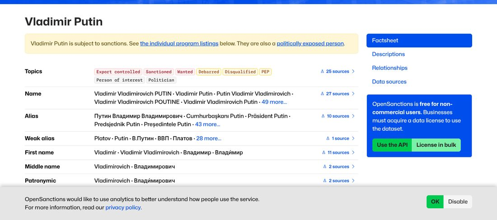<figcaption><b>OpenSanctions entity page (Vladimir Putin).</b> A status banner first. Then a factsheet where every row has "N sources ›" on the right (provenance one click away) and long lists end in "49 more…". A right-hand rail jumps between Factsheet, Descriptions, Relationships, Data sources.</figcaption></figure>
<figure>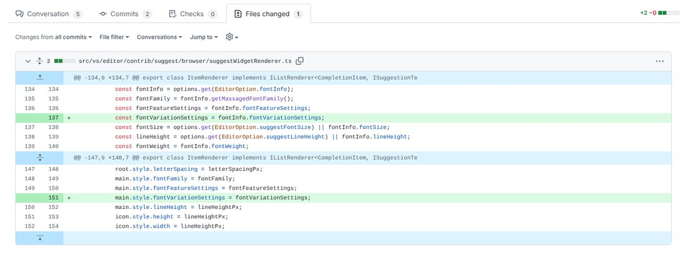<figcaption><b>GitHub pull request, Files changed.</b> Unchanged lines collapse to a blue bar with expand arrows above and below; each file has a collapse caret and a change bar; tabs carry counts (Conversation 5, Commits 2…).</figcaption></figure>

- **Take:** "N sources ›" on every fact row is your "every fact one click from its source" rule, done in one small element. "49 more…" is your "found / shown" rule. The blue expand bar is a good model for a folded run of low-value records: it says what is folded and offers it back in place.
- **Avoid:** OpenSanctions' lists show the first handful in arrival order; yours should show the ones that matter first (flags, disputes, failures), then the rest.
- **Your rules:** compatible. Nothing is hidden without a count.

<figure>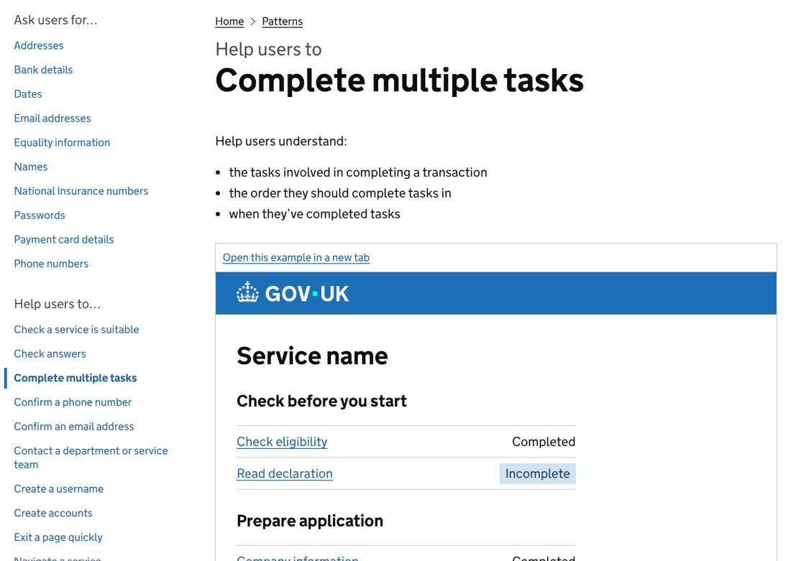<figcaption><b>GOV.UK "Complete multiple tasks".</b> A long process becomes named groups of tasks, each with a plain status word (Completed / Incomplete). Order and progress are visible without opening anything.</figcaption></figure>
<figure><figcaption><b>Wikipedia (1MDB article).</b> Hover over "Najib Razak" gives a preview card (peek) that opens nothing. Contents and Appearance both have a "hide" control. Appearance holds text size, width and colour, the way a reader sets density.</figcaption></figure>

- **Take:** the task list is the right shape for "what's left before this story can run": Story's five gates plus To check plus Right of reply in one list of named groups with a word each. The peek card is depth 2 in the Concept Lab (B).
- **Avoid:** a task list that grows to dozens of lines. GOV.UK's example uses short groups of two or three tasks.

<figure>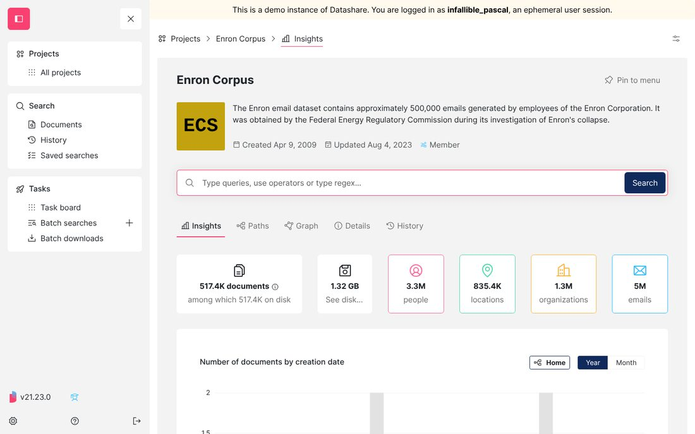<figcaption><b>ICIJ Datashare (demo), project page.</b> Left sidebar in three named groups (Projects, Search, Tasks), collapsible with one button. Tabs for Insights / Paths / Graph / Details / History. Counted tiles for people, locations, organisations, emails.</figcaption></figure>
<figure>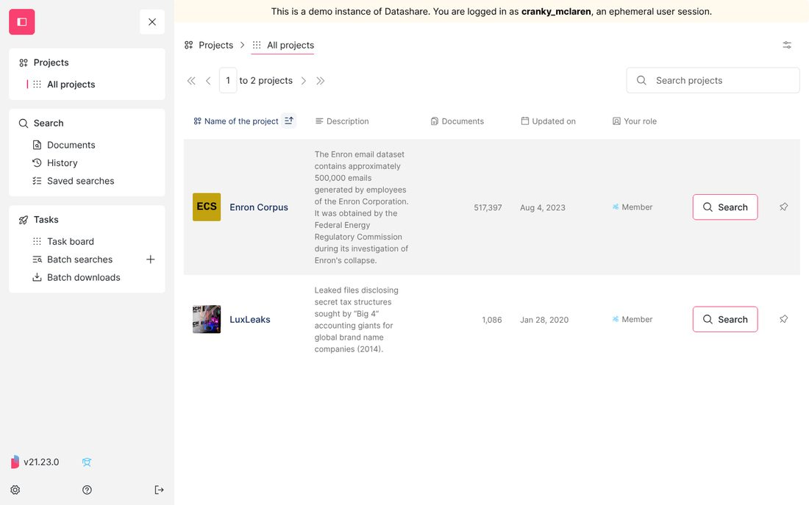<figcaption><b>Datashare first load.</b> A Start / Skip tour modal opens at the first visit. The tool journalists already use asks once, offers to skip, and shows its sidebar behind.</figcaption></figure>

- **Take:** the tiles-then-tabs layout is close to your Case home. The tour is the discovery pattern most familiar to this audience.
- **Avoid:** a long tour. NN/g-attributed guidance (secondary) says people who read upfront tutorials rated apps as more complex and were not more proficient. I could not verify that source.

### 5.2 One switch for how much you see

<figure>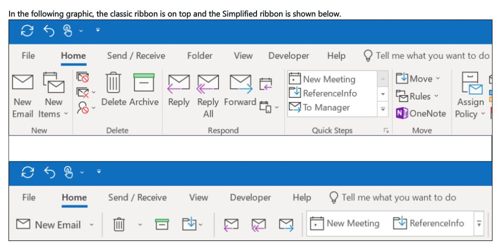<figcaption><b>Microsoft Outlook, Classic ribbon above, Simplified ribbon below.</b> Same commands, same tabs; the simplified version drops the group labels and shows one row of icons. The page says the toggle is a caret at the lower right of the ribbon.</figcaption></figure>

- **Take:** a switch that is **in the same place as the thing it changes**, with the "before" and "after" documented as a pair. It is also an example of a setting the user controls (Findlater: preferred).
- **Avoid:** the Simplified ribbon removes labels, which costs learnability for new people. Your "Less" level should remove depth, not names.

<figure>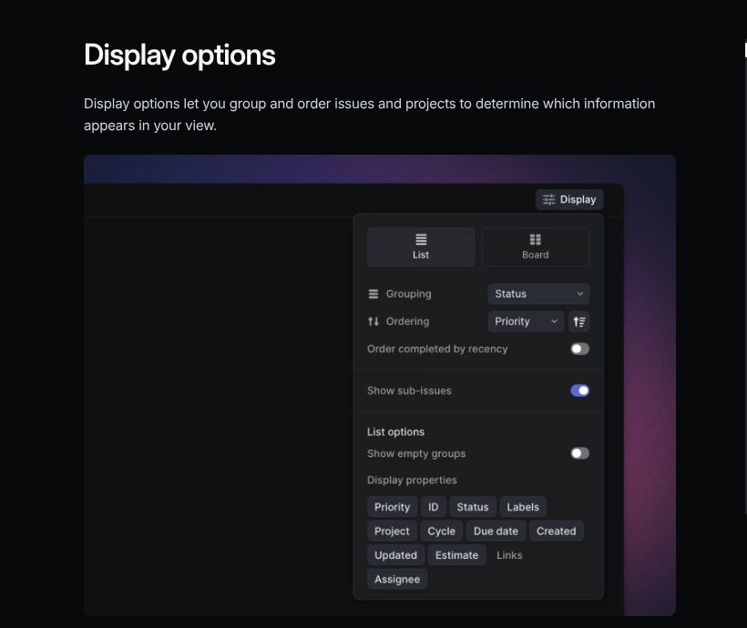<figcaption><b>Linear, "Display options".</b> One popover per view: List/Board, Grouping, Ordering, "Show empty groups", and a row of property chips (Priority, ID, Status, Labels…) that you switch on and off. The settings can be saved per view.</figcaption></figure>
<figure>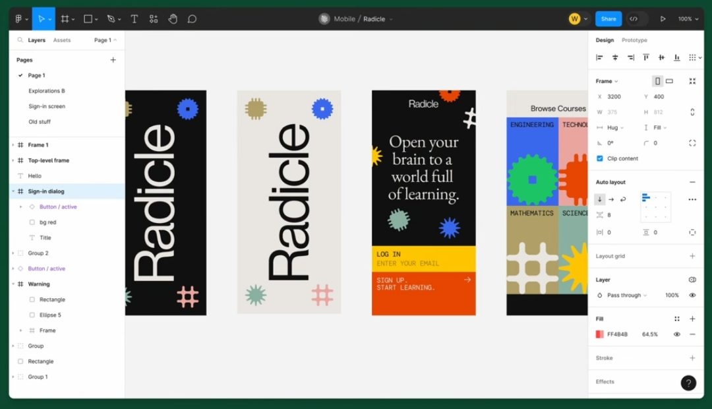<figcaption><b>Figma UI3.</b> Floating toolbar, layers left, properties right. Figma's post says the old "Hide UI" was blunt, so UI3 added "Minimize UI" that collapses side panels while keeping tools reachable. Forum threads show users objecting when it was forced on them (anecdotal).</figcaption></figure>

- **Take:** Linear's chips are a model for per-screen "what each card shows". Figma's "Minimize" is a model for a middle state between everything and nothing.
- **Avoid:** forcing. The UI3 backlash and Office 2000's personalised menus are the same lesson from two directions: do not change the layout under people.
- **Also checked (text only, no useful picture):** Apple's Assistive Access (a few large tiles, Phone and FaceTime merged into one Calls app, a Back button always present, a trusted person helps set it up, its own passcode, switched on in Settings); Photoshop's Contextual Task Bar (on-canvas actions based on your selection, so you "reduce the need to switch between panels"); DaVinci Resolve's separate pages (Cut, Edit, Color, Fairlight, Deliver) that each show only their own tools; VS Code's Zen mode and a movable or hideable Activity Bar.

### 5.3 Graphs and maps that avoid the hairball

<figure>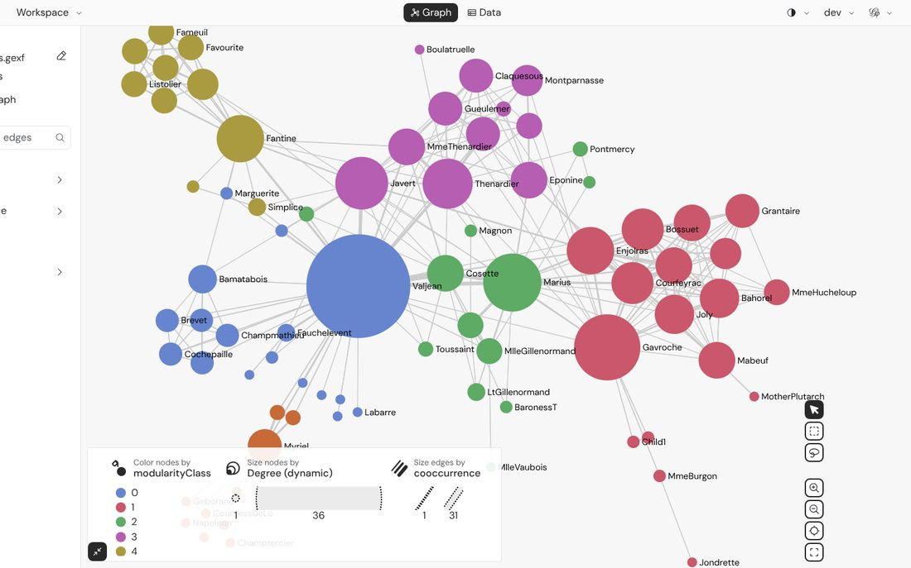<figcaption><b>Gephi Lite, Les Misérables sample.</b> Even a modest graph is a lot. The strip at the bottom is a legend that says what colour and size mean ("Color nodes by modularityClass / Size nodes by Degree / Size edges by cooccurrence"). Panels at the left are collapsed behind chevrons.</figcaption></figure>
<figure>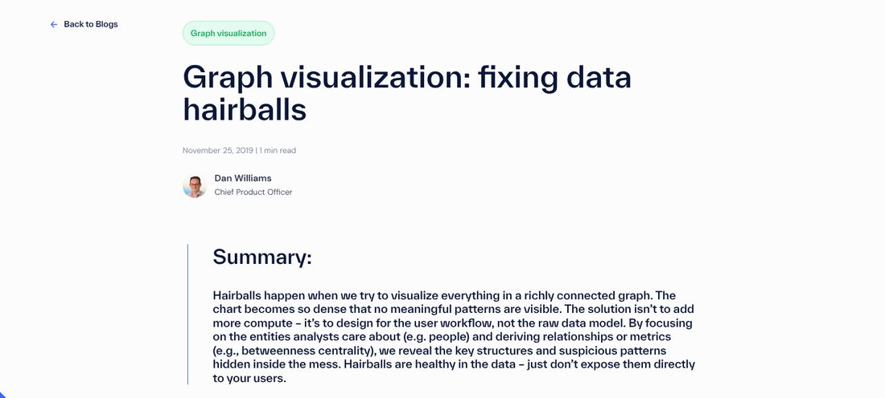<figcaption><b>Cambridge Intelligence on hairballs.</b> The summary is the design rule: keep the hairball in the data, do not expose it to users.</figcaption></figure>

<figure>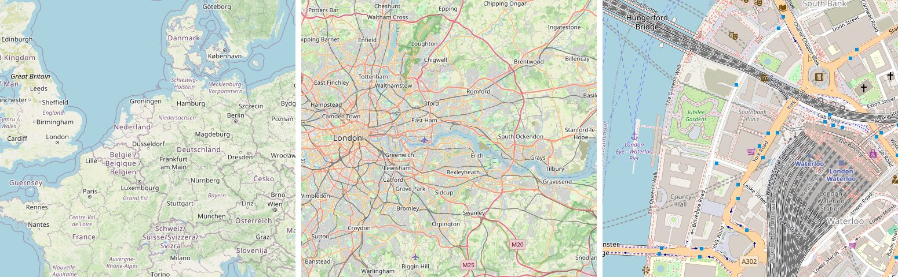<figcaption><b>OpenStreetMap at three zooms (country, city, street).</b> What a map <i>is</i> changes with altitude: countries and cities, then boroughs and rivers, then buildings and shop names. Nothing is "hidden"; it is the same data at a different level of detail. (A promo banner covers the left of the real page; I cropped it out.)</figcaption></figure>

- **Take:** semantic zoom, not just scale. The Wire already has three altitude stops; Concept Lab (C) applies the same idea to a 15,000-item queue. Gephi's "what this encoding means" strip matches your SEE_1 legend ("How sure / Always on").
- **Your rules:** the SEE_1 legend is "always on" by your design, which fits the floor.

### 5.4 The two extremes

<figure>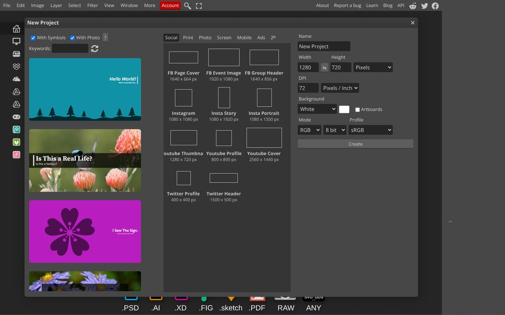<figcaption><b>Photopea, New Project.</b> Everything at once: presets in five tabs, a column of previews, and the full set of advanced fields (DPI, mode, bit depth, profile) beside them. Powerful, and the first thing a new user sees.</figcaption></figure>
<figure>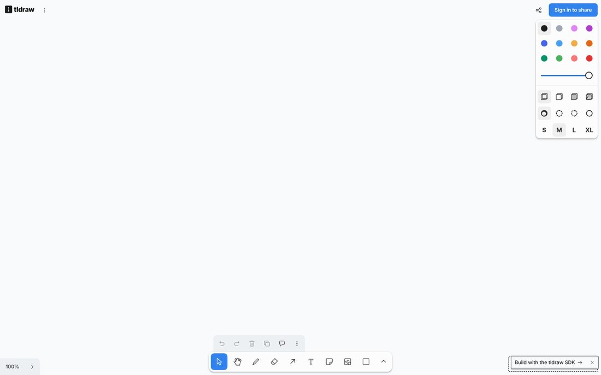<figcaption><b>tldraw.</b> An empty canvas, one floating toolbar, one overflow arrow. When something is selected, a style panel appears at the right with colours, line, size.</figcaption></figure>

Your Library and Relationships panels sit nearer Photopea; the redesigned Case home sits between. tldraw shows how little has to be on screen when the actions follow the selection (idea E).

<figure>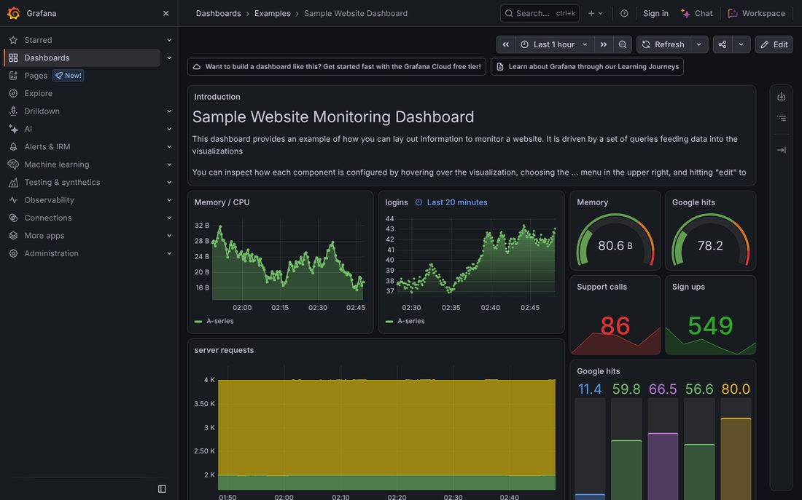<figcaption><b>Grafana sample dashboard.</b> A grouped navigation (Starred, Dashboards, Explore… each collapsible with a chevron), a time control, and panels that share a single time range. The right-hand rail holds outline and tools.</figcaption></figure>

### 5.5 Disclosure that is deliberately not skippable

<figure>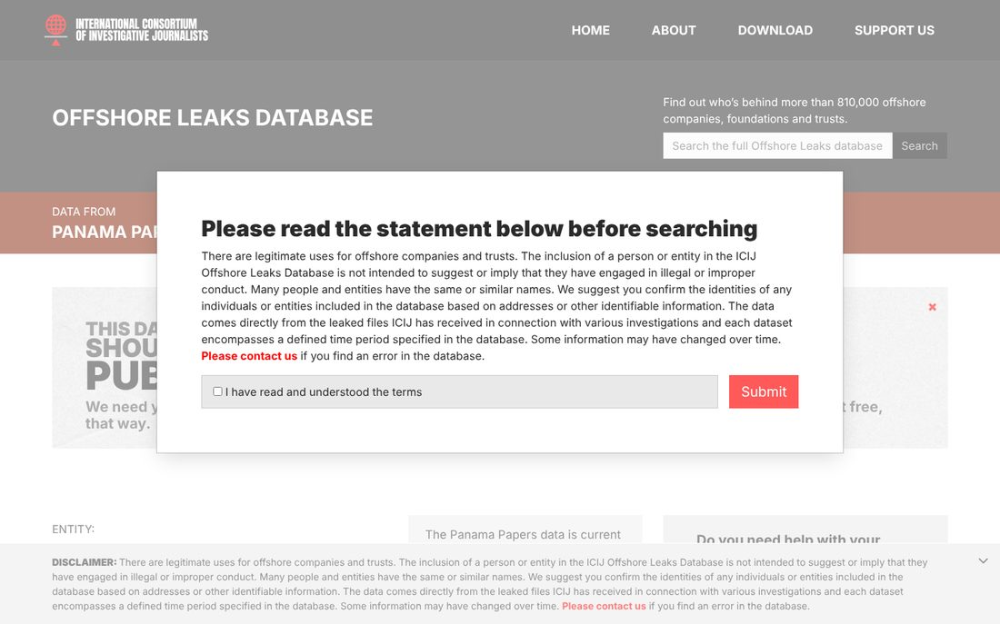<figcaption><b>ICIJ Offshore Leaks Database, before searching.</b> A modal makes you read and tick "I have read and understood the terms" before you can search (the statement says inclusion is not intended to imply improper conduct), and a shorter disclaimer stays pinned along the bottom afterwards.</figcaption></figure>

- **Take:** this is the same logic as your floor. When something must not be skipped, make it a deliberate one-time step and then keep a quiet permanent reminder. Your "indicator, not a finding" line and the Strong/Textbook safety notice follow that pattern.

## 6. Where we stand against these

| Pattern | Seen at | In the Workbench today | Gap |
|---|---|---|---|
| Fold with a count | OpenSanctions, GitHub | Money folds "top 20 flows plus others (n)"; `
` in 10+ places | Not a shared pattern; counts not on every fold |
| Selection-driven actions | tldraw, Photoshop | Decide cards, Reading-room selection bar | Library and Relationships still show every action |
| Peek / hover preview | Wikipedia | Glossary hover cards | No peek on records |
| Altitude / semantic zoom | OSM, Cambridge | The Wire altitude (3 stops) | Not on lists or the queue |
| One switch for amount | Outlook, Linear, Wikipedia | Calm motion and effects level; Format variants (planned) | No setting for amount of detail |
| First-run offer | Datashare | Edge hint chips on first use | No tour or role question |
| Not-skippable disclosure | ICIJ | Gates, "indicator, not a finding", type-to-confirm | Already strong |
| Task list for readiness | GOV.UK | Story gates (5) | Gates live inside Story only |
| Try before keep | (Appearance bar) | **Try, Keep, Compare in Appearance** | Reuse for detail levels |

The Appearance "Try / Keep / Compare" bar is the most useful thing already built for this study: it is exactly the safe way to offer a detail level.

## 7. A proposal

### 7.1 Eight rules

1. **The floor never folds** (§3), at any level.
2. **A fold carries its count and state.** "Claims · 21 confirmed · 9 disputed · 4 unverified", never just "Claims".
3. **Offer, never impose.** The app may suggest a level; only the person sets it.
4. **Events add attention, never remove position.** A new failure pulses a spine; it does not open a drawer over what you are doing.
5. **Four things at a time.** About four named groups compete in any region; more become groups of groups.
6. **Depth is a ladder, not a jump.** Line, peek, opened in place, the room. Escape returns to the same row.
7. **Values do not animate.** Highlight a changed number; do not count it up. (This is already in the code comments.) Motion shows where something went, with a reduced-motion fallback.
8. **Hidden is findable.** ⌘K finds folded things and reveals them; folded lines say "show".

### 7.2 Three levels, plain words

Name candidates: **Less / Usual / Everything.** Not "Beginner / Expert": I found nothing that shows people choose those honestly, and the words judge the person rather than describe the screen. The Media Suite calls its switch "Detail: Full / Calm"; the app has "Calm motion". Two different "calm" settings will confuse; see §8.

<table>
<tr><th>Area</th><th>Less</th><th>Usual</th><th>Everything</th></tr>
<tr><td>Navigation</td><td>Five stages; parts appear after you arrive</td><td>Stages + parts (today)</td><td>+ pages, console, trail</td></tr>
<tr><td>Case home</td><td>Question, Next up, three numbers (supported, disputed, to check), "since you were away"</td><td>As mockup HOME_1</td><td>+ year rail, pointing-at, key hints</td></tr>
<tr><td>Decide card</td><td>Question, passage, three answers</td><td>+ keys, "what happens", kind chips</td><td>+ queue by group, bulk actions (sort by what it unlocks is still on the build list)</td></tr>
<tr><td>Claims</td><td>Status, statement, source count, likelihood word</td><td>+ evidence grade, classification</td><td>+ warrant, assumptions, limitations, confidence basis, review events</td></tr>
<tr><td>Sources</td><td>Tier as a word (reliable / unclear)</td><td>Tier A–F</td><td>+ authenticity, restatement, four dates</td></tr>
<tr><td>Red Flags</td><td>Flag, floor items, add to leads, set aside</td><td>+ picture it rests on, show in money</td><td>+ rule version, weight parts, detector, history</td></tr>
<tr><td>Money</td><td>Columns or flow, "traced so far"</td><td>+ ledger, currency tabs</td><td>+ integrity checks, all rows</td></tr>
<tr><td>The Wire</td><td>Around one party, top altitude</td><td>+ whole case, follow the money</td><td>+ path box, arrangements, as-of rail</td></tr>
<tr><td>Outside lookups, OpenAleph</td><td>One search; findings arrive in Decide with provenance</td><td>Findings list</td><td>Enrichment sessions, xref, entity sets, corpus sync</td></tr>
<tr><td>Entity resolution</td><td>Merge candidates in Decide</td><td>+ conflicts</td><td>+ audit, post-merge reconciliation</td></tr>
<tr><td>AI runs</td><td>Ask, what leaves the computer, review</td><td>+ the plan</td><td>+ operating instructions, tier floor, devil's advocate</td></tr>
<tr><td>Learn</td><td>Glossary + the indicators the app computes</td><td>+ catalogue by area</td><td>All 2,946, with checkability filter</td></tr>
<tr><td>Library</td><td>Rows; actions on selection</td><td>+ filters</td><td>+ bulk import, relationship staging</td></tr>
<tr><td>Settings</td><td>Appearance, Keyboard, Your safety</td><td>+ Outside lookups, Demo</td><td>+ Access, keys, backups, security log</td></tr>
<tr><td>Themes, effects</td><td>Theme only</td><td>+ effects level</td><td>+ named effects, theme maker</td></tr>
</table>

**At every level:** the 12 floor items. A Strong flag at "Less" shows the same level, "indicator, not a finding" and innocent-explanation checklist as at "Everything"; only the rule weights fold.

**How it would be built.** There is already a mechanism of the right shape: `data-motion="calm"` on `<html>`, set from the `Appearance` object in `lib/theme.ts`. A `data-detail` attribute would work the same way, with each element carrying a tier. A small shared "folded" component would draw the count line, so every fold says "N folded · show". I haven't built or tested this; it is a pointer for the build list, not a plan.

### 7.3 How would people know

None of these changes anything silently.

| Mechanism | When | Notes |
|---|---|---|
| **A question when the first case opens** | Once | "How much do you want to see?" Three cards, each with a live preview of the Red Flags screen. Skippable. Datashare-style, but one question, not a tour. |
| **A switch in the top edge** | Always | Same place as Hide screen and Switch case, with a one-word state. Outlook's caret is the model: next to the thing it changes. |
| **⌘K commands** | Always | "Show less", "Show everything". Also finds folded things by name and offers to reveal them. |
| **An offer on a crowded screen** | Only when a screen has stayed busy | Example trigger: four sections opened in a minute, or a long dwell with no action. The offer is a small card: "Try Less for 20 seconds?" with Try / Not now / Don't ask again. Try uses the Appearance bar: Keep or Undo. At most once a session. |
| **Fold lines** | Wherever something is folded | "9 folded: how it was computed · show". |
| **"Always show this"** | After you open the same fold three times | Graduates that one fold to open for you. Shneiderman's "climb the layers", one feature at a time. |
| **Demo and tutorial default to Less** | The 1MDB tutorial case | A person following the tutorial sees the smallest set, and the tutorial says where "Usual" begins. |

Not recommended: choosing the level for people from how they behave (Findlater); a long tour (Datashare's is short and skippable; the only evidence I found for the cost of long ones is secondary).

### 7.4 Ideas, by screen

Pictures for A–E are in the Concept Lab frames below.

| # | Idea | Where it helps most | Trigger and motion | Floor check |
|---|---|---|---|---|
| A | **Spine and open part.** The section you are in opens; the others fold to one line with count and state. | Stage pages (Check 4 sections, Bring in 6, See 5, Act 6) | Click, keys 1–4, or a pause over a spine. The open part grows (380 ms), the others shrink; contents fade in after. | Disputed and failed counts stay on the spine |
| B | **Four depths per record.** Line, peek on hover or focus, opened in place, the room. | Claims, payments, documents, flags | Hover (220 ms peek), click (grows in place), Enter (card becomes room, container transform); Esc returns to the same row | Who, what, how much, when, where from at depth 1 |
| C | **Zoomable lists.** Whole queue as 6 counted groups, groups open, records. | Decide queue (about 15,000), Library, Claims, Timeline | Altitude control or wheel over the list; groups unfold in place | "Found · shown · why" line always on |
| D | **One detail switch with a floor.** Less / Usual / Everything. | Everywhere, starting with Red Flags | Tier folds shrink and fade (380 ms); "N folded" line updates | Floor items outlined and never fold |
| E | **Actions on selection.** Rows show two actions on hover; selecting raises one bar of actions that fit the selection. | Library (44 buttons today), Relationships, Connectors | Bar slides up (220 ms); swaps its set when one becomes several | Destructive actions still confirm |
| F | **Readiness list.** Story gates, To check, right of reply in one list of named groups with a status word. | Story and Case home | Group opens in place; status word changes with a highlight | Gates are the floor |
| G | **Quiet majority.** Show the exceptions, fold the fine. (The Media Suite already does this with its quiet marks.) | Chain of custody, Red Flags (37 flags, 31 identical), Money checks | Fold shows "31 payments · same rule · open" | The count and the exceptions stay |
| H | **One navigation.** Breadcrumb becomes the section switcher; left edge and ⌘K keep their jobs; drop the repeated section tab strip once spines exist. | Frame | Breadcrumb opens a small menu; same dwell and keys | None affected |
| I | **Learn tells the truth.** Default filter "what the app checks" (7 rules); the rest labelled reference and checklist. | Learn | Filter chip | No finding hidden; it names what is not computed |
| J | **Settings opens one group at a time** (it already has three: You, Cases, This computer) and starts at search. | Settings | Group opens in place; search highlights | n/a |
| K | **Overlay rules.** Four kinds only: peek (hover), one side drawer at a time with a trail, a full room (Reading room, Custody), a dialog only for irreversible actions. | All | Opening a second drawer replaces the first with a slide, not a stack | n/a |
| L | **Keys on demand.** Show a key hint after the same mouse action three times; one `?` that lists the keys of the screen you are on. | All | Hint chip fades in once; "don't show again" | n/a |

<figure>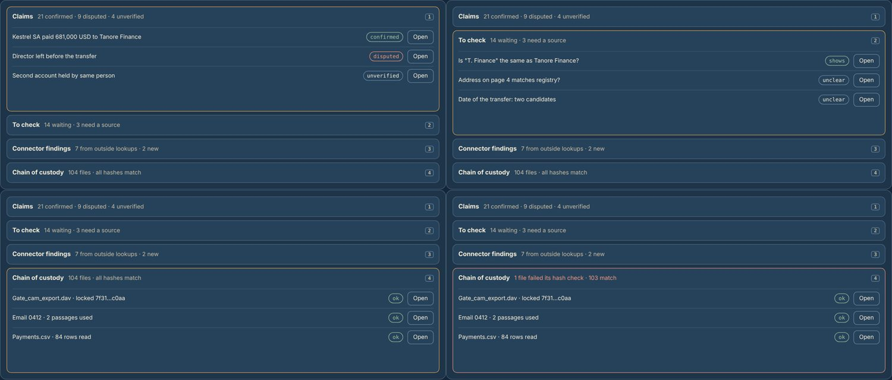<figcaption><b>Concept Lab A, four frames.</b> Claims open (top left). To check open, Claims folded to a spine that keeps its numbers (top right). Chain of custody open (bottom left). A file fails its hash check: the Chain of custody spine changes its own line to red and pulses twice while the reader stays where they were (bottom right).</figcaption></figure>

<figure>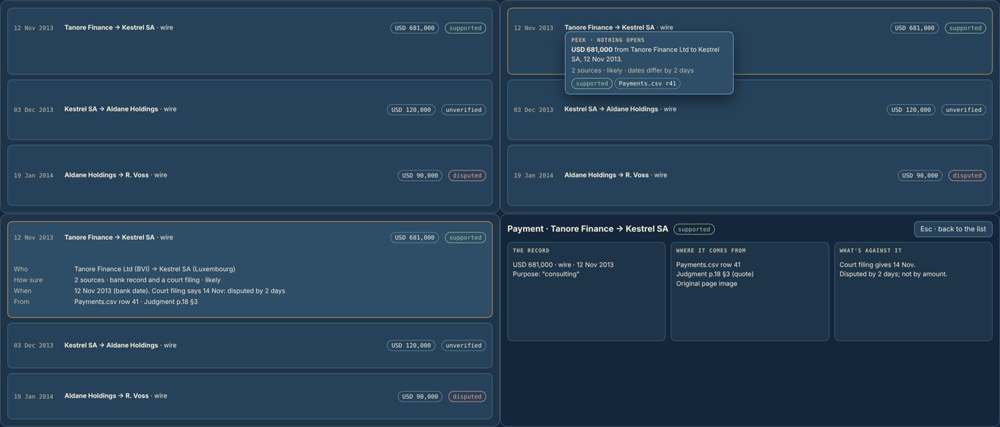<figcaption><b>Concept Lab B, four depths of one payment record.</b> 1 Line. 2 Peek on hover (nothing mounted). 3 Opened in place (the list keeps its position). 4 The room (container transform).</figcaption></figure>

<figure>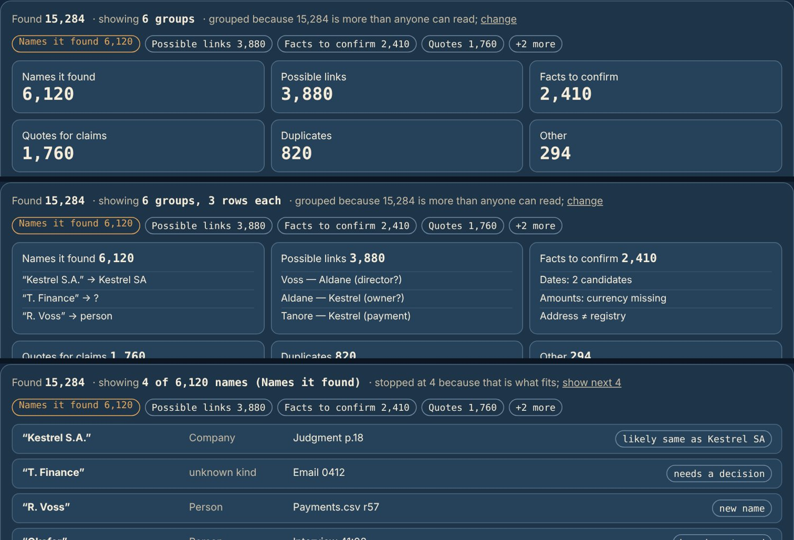<figcaption><b>Concept Lab C, a 15,284-item queue at three altitudes (top to bottom).</b> Six counted groups; groups with three rows each; the records of one group. The line "Found · showing · why" never leaves. All counts in the lab are invented.</figcaption></figure>

<figure>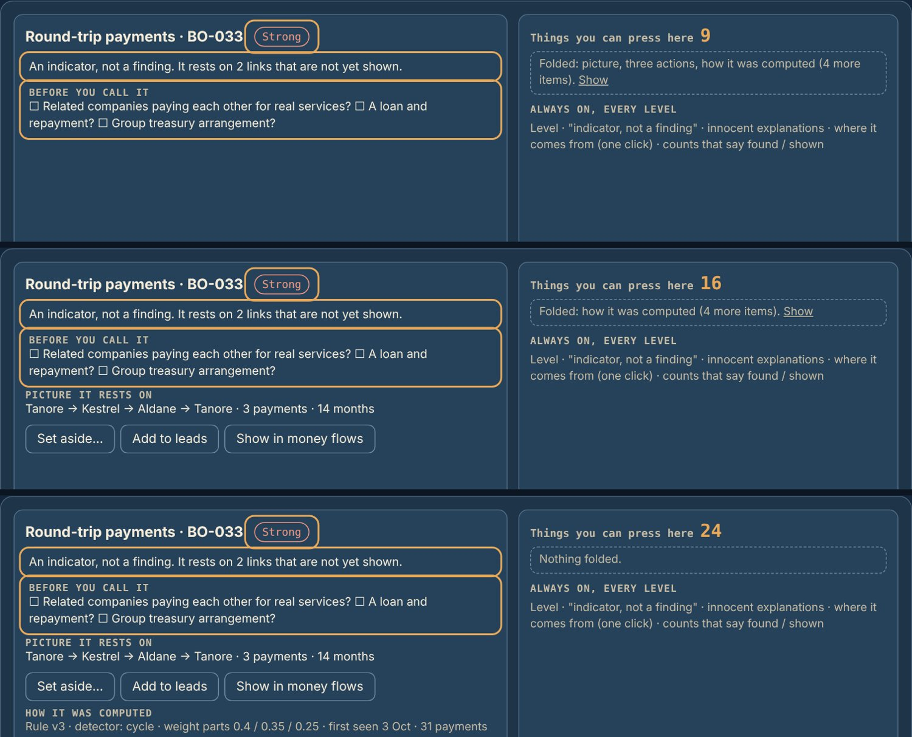<figcaption><b>Concept Lab D, Red Flags at Less, Usual, Everything (top to bottom).</b> The outlined parts are the floor. The right column counts what you can press and says what is folded. (The counts 9 / 16 / 24 are illustrative.)</figcaption></figure>

<figure>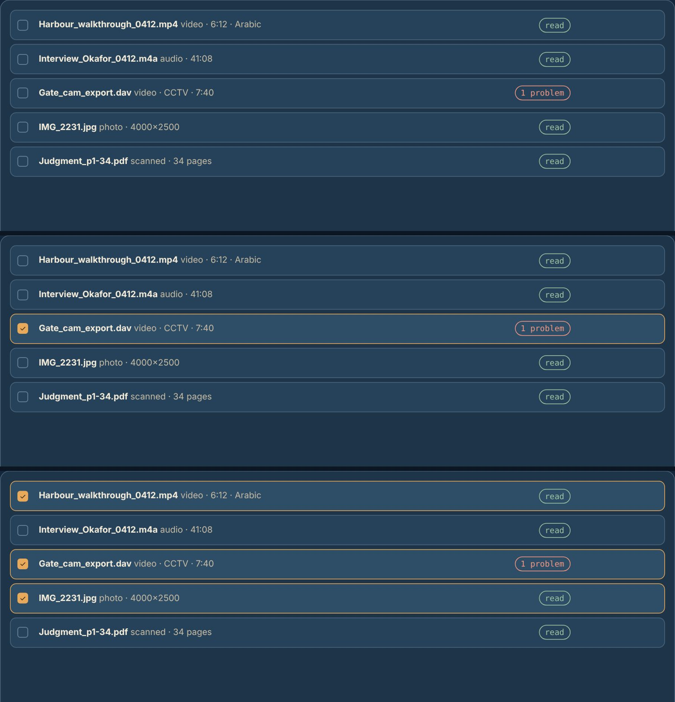<figcaption><b>Concept Lab E, actions follow the selection (top to bottom).</b> Nothing selected: rows are lines. One selected: three single-file actions. Three selected: actions that work on a set, including Compare.</figcaption></figure>

### 7.5 Animation and event triggers: a vocabulary

| Trigger | Response | Duration and curve | Reduced-motion fallback |
|---|---|---|---|
| You select or focus something | Outline plus peek or action bar | 120–220 ms, ease-out | Instant |
| You pause over a spine | Part opens in place | 380 ms | Instant |
| You open a record | Card grows into its room (container transform); Esc grows it back to the same row | 380 ms | Cross-fade or instant |
| You move between stages | Shared axis slide, direction = forward or back | 220 ms | Instant |
| A count changes | Highlight ring on the number; no counting up | one pulse, 360 ms | Static ring until you look |
| A new failure or flag arrives | Spine pulses twice and changes its own line; a bell count rises | 2 × 1.1 s | Border turns alarm colour and stays |
| An AI run finishes | Existing run bloom on the spine, a "ready to review" line | existing | existing |
| A decision resolves | The card leaves in the direction of its answer; undo stays 8 s (existing) | 220 ms | Instant |
| A screen has stayed crowded | An offer card (never a change) | 220 ms in, stays until answered | Same |
| Zoom (altitude) changes | Groups unfold or fold in place so the eye keeps its place; staged, not a cross-fade | 380 ms | Instant |

**Limits.** One automatic motion at a time. No motion longer than 450 ms. Nothing moves the thing you are reading. Every motion has a still frame (the Concept Lab's "Calm motion" button shows each one). Staged animation helped in Heer and Robertson's experiments but sometimes lengthened response time in a later study, so the lab keeps durations short.

### 7.6 Order of work

My estimate of size, not a measurement.

| Step | What | Size | Why this order |
|---|---|---|---|
| 1 | **Overlay rules (K), one navigation (H), keys on demand (L)** | S–M | Removes repetition without a new setting |
| 2 | **Actions on selection (E)** for Library and Relationships | M | The two heaviest screens; matches the redesign already pending |
| 3 | **Spine and open part (A)** on stage pages; the shared "folded" component | M | Gives every later fold its count line |
| 4 | **Four depths (B)** for claims and payments | M | Peek and in-place open reuse step 3 |
| 5 | **Detail levels (D)** plus the first-case question and the top-edge switch | M–L | Needs the tier tags from steps 3–4 |
| 6 | **Zoomable lists (C)** for Decide, Library, Timeline | L | Needs a server-side grouping for 15,000 items |
| 7 | **Offer on a crowded screen, "always show this"** | S | Needs levels (5) |
| 8 | **Learn truth (I), readiness list (F), quiet majority (G)** | S–M each | Independent; can go any time |

## 8. Open questions for you

1. **Words.** Less / Usual / Everything, or other words? The Media Suite's "Detail: Full / Calm" and the app's "Calm motion" collide; should the Media Suite switch be renamed?
2. **Scope of the setting.** One level for the whole app, per case, or per screen? I lean to one global level plus a per-fold memory ("always show this").
3. **Default.** New people and the tutorial default to Less; everyone else to Usual?
4. **Offers.** May the app offer a level on a crowded screen (never apply it), at most once a session?
5. **Safety notices at Less.** Your open question from the backlog (may notices interrupt) matters here: at Less, does a Strong safety notice still sit at the top of the case?
6. **Spines versus the section tab strip.** Should spines replace the strip on stage pages, or sit with it?
7. **Format variants.** Editorial, Desk and Story are planned layouts. Are they about how things look, so separate from how much shows? If they were meant partly to be simpler views, they overlap with levels.
8. **Library.** May "Bulk import" and "Stage relationship from a reviewed claim" leave the Library for The Drop and the claim screen?
9. **Folded counts everywhere.** Is it right to show "N folded · show" on every fold, even where it adds a line?
10. **Learn default.** Should Learn open filtered to the 7 indicators the app computes, with the rest marked reference?
11. **First.** Which screens come first: the two heaviest (Library, Relationships) or the ones people see first (Case home, Decide)?

## 9. What I checked, and what I did not

**Checked**

- The app inventory came from two read-only code surveys (routes, feature folders, tabs, dialogs, settings, existing mechanisms) and a data and doctrine survey; I read their reports and your mockups. I did not run the app. Control counts are static greps (lower bounds); "visible" counts are estimates.
- I looked at about 40 screenshots taken in a headless browser at 1440×900, including live apps (Gephi Lite, Datashare demo, Photopea, tldraw, Grafana, Wikipedia) and documentation pages. The Media Suite board was rendered from its published HTML; the 58-control count is a count of visible buttons, tabs and links on first load.
- Hover and click states were captured only where noted (Wikipedia preview, Datashare tour and project page).

**Not checked, or only partly**

- **Papers.** Carroll &amp; Carrithers (1984/1986), Findlater &amp; McGrenere (2004), Heer &amp; Robertson (2007) and Shneiderman (1996, 2002) were read as abstracts, excerpts and citing summaries; the full texts are behind paywalls or I did not open the PDFs. The findings quoted are what those summaries state. Figures such as the "quarter of their time" come from a summary of the CACM paper.
- **Hick's law and Cowan** come from secondary UX write-ups and a Cowan abstract; I did not read Hick and Hyman's originals.
- **NN/g onboarding and "push vs pull"** I could not source to NN/g; only vendor pages repeat it. Treat as a hypothesis.
- **Material container-transform duration (450 ms)** is from a third-party page.
- **Bloomberg, Notion's help page and Palantir's product screens** were unavailable (blocked or no useful picture). Apple's Assistive Access, Photoshop's Task Bar, DaVinci Resolve and VS Code were read as text and a page picture, not in use.
- **Figma UI3.** I read Figma's post and forum threads; forum comments are anecdotal.
- **Search tooling.** The Firecrawl credits ran out partway, so later searches used the built-in web search, which returns summaries, not full pages.
- **Your own users.** Nothing here comes from watching someone use the Workbench. Whether people at your target level would choose "Less" correctly, or notice an offer, is untested; the Concept Lab is the cheapest way to find out.
- **Whether the Learn screen tells people that only 7 of 2,946 indicators are computed:** not confirmed.

## 10. Sources

Looked at as pages (screenshot): Cambridge Intelligence, "Graph visualization: fixing data hairballs" · GOV.UK Design System: Complete multiple tasks, Details, Accordion · OpenSanctions entity page · ICIJ Offshore Leaks Database · ICIJ Datashare demo · Gephi Lite · Linear docs, Display options · Figma blog, "Inside the redesigned Figma" · Microsoft Support, "Use the Simplified Ribbon" · Photopea · tldraw · Grafana play · GitHub pull request page · Wikipedia, 1MDB · OpenStreetMap · Material Design 3 transitions · Apple HIG, Disclosure controls and Motion · Apple Assistive Access guide · Adobe Photoshop help, Contextual Task Bar · Blackmagic DaVinci Resolve.

Research (abstract or summary level unless noted):

- Shneiderman, B. (1996). *The Eyes Have It: A Task by Data Type Taxonomy for Information Visualizations.* UMD technical report.
- Shneiderman, B. (2002/2003). *Promoting Universal Usability with Multi-Layer Interface Design.* https://www.cs.umd.edu/~ben/ACM-CUU2003.pdf
- Carroll, J. M. &amp; Carrithers, C. (1984). *Training wheels in a user interface.* CACM 27(8); and *Blocking learner error states in a training-wheels system,* Human Factors 26(4).
- Findlater, L. &amp; McGrenere, J. (2004). *A comparison of static, adaptive, and adaptable menus.* CHI '04. https://www.cs.ubc.ca/labs/edapt/papers/findlater2004.pdf
- Cowan, N. (2001). *The magical number 4 in short-term memory.* Behavioral and Brain Sciences. https://memory.psych.missouri.edu/assets/doc/articles/2001/cowan-bbs-2001.pdf
- Weiser, M. &amp; Brown, J. S. (1995). *Designing Calm Technology.* https://calmtech.com/papers/designing-calm-technology
- Heer, J. &amp; Robertson, G. (2007). *Animated Transitions in Statistical Data Graphics.* IEEE TVCG 13(6). https://homes.cs.washington.edu/~jheer/files/2007-AnimatedTrans-InfoVis.pdf
- Cockburn, A., Karlson, A. &amp; Bederson, B. (2009). *A review of overview+detail, zooming, and focus+context interfaces.* ACM Computing Surveys. https://www.microsoft.com/en-us/research/wp-content/uploads/2008/01/cockburn-ComputingSurveys09.pdf
- Nielsen Norman Group, *Progressive Disclosure.* https://www.nngroup.com/articles/progressive-disclosure/
- Cambridge Intelligence, *Introducing combos* and the combining-nodes showcase.
- Figma, *Our approach to designing UI3.* https://www.figma.com/blog/our-approach-to-designing-ui3/
- Apple, *Assistive Access User Guide.* https://support.apple.com/guide/assistive-access-iphone/welcome/ios
- Microsoft, *Use the Simplified Ribbon.* https://support.microsoft.com/en-us/outlook/use-the-simplified-ribbon

Project files used: `docs/project-notes/START_HERE.md`, `MOCKUP_BUILD_LIST.md`, `BACKLOG.md`, `DEMO_CASES.md`, `docs/design/mockups/*`, `frontend/styles/themes.css`, the Authority System Suite `AGENTS.md` and doctrine files, and the Media Suite board (Artifact "Media Suite").
